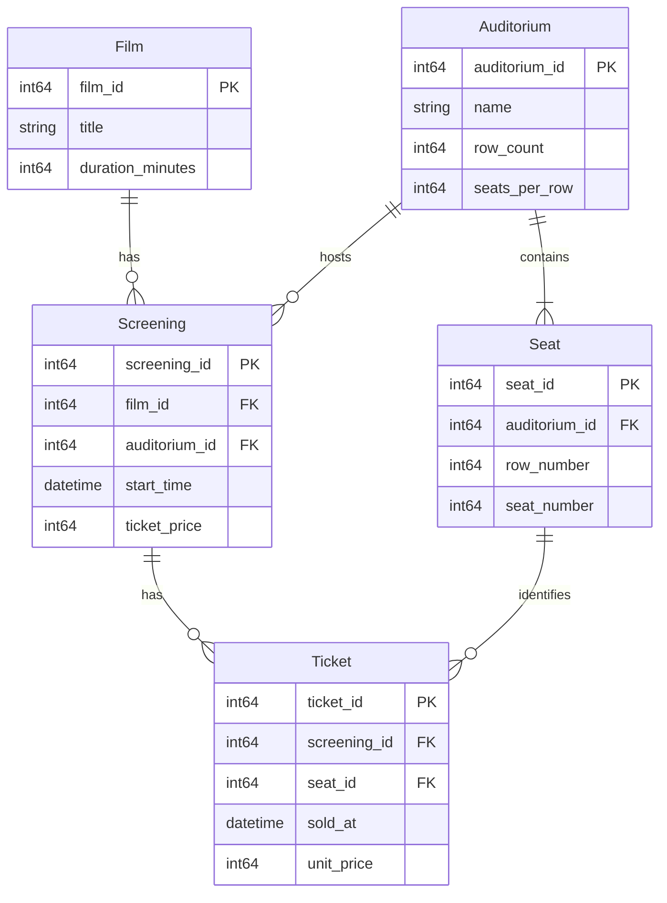

# THIẾT KẾ CƠ SỞ DỮ LIỆU LOGIC

**Cập nhật:** 26/10/2026. Đối chiếu với mã nguồn; đọc cùng
[thiết kế lớp](class-design.md) và [hướng dẫn vấn đáp](../study-guide.md).

## 1. Phạm vi

Thiết kế cho một rạp, một người vận hành, mỗi lần bán một vé. ERD mô tả dữ liệu và quan hệ nghiệp vụ; dữ liệu thực tế lưu TXT, nạp lên RAM khi mở và lưu khi thoát bình thường. Không sử dụng DBMS hoặc SQL.

Phân biệt ba mức khi trình bày:

| Mức | Trong bài này |
|---|---|
| Khái niệm | Thực thể, quan hệ, lực lượng tham gia trong ERD |
| Logic quan hệ | Lược đồ, thuộc tính, khóa chính/ngoại, khóa ứng viên, phụ thuộc hàm |
| Lưu trữ thực tế | Năm TXT và các container C++ trên RAM; không có bảng SQL được DBMS quản lý |

Tên “khóa ngoại” trong tài liệu là ràng buộc của mô hình.
File TXT không tự thực thi `FOREIGN KEY`, `UNIQUE` hoặc giao dịch.

## 2. ERD



Mỗi suất thuộc đúng một phim và một phòng; mỗi ghế thuộc đúng một phòng; mỗi vé thuộc đúng một suất và một ghế. Phim, phòng, suất hoặc ghế có thể chưa có bản ghi con, riêng phòng hợp lệ phải có đủ ghế theo cấu hình.

**Quy ước:** PK là khóa chính số nguyên dương do chương trình sinh, duy nhất trong từng thực thể và không được sửa; FK là khóa ngoại bắt buộc tồn tại. Mọi trường bắt buộc có giá trị. Tên không rỗng, không dùng làm khóa vì có thể trùng hoặc thay đổi. Tiền dùng số nguyên 64 bit, đơn vị VND; thời gian dùng giờ địa phương, định dạng `YYYY-MM-DD HH:mm`.

## 3. Lý do chọn thực thể và thuộc tính

| Thực thể | Lý do thiết kế |
|---|---|
| `Film` | Một phim có nhiều suất nên lưu tên và thời lượng một lần, tránh lặp trên từng suất. Thời lượng dùng tính giờ kết thúc. |
| `Auditorium` | Phòng tồn tại độc lập với lịch. Lưu số hàng và số ghế mỗi hàng vì sơ đồ chỉ là hình chữ nhật; sức chứa tính từ hai giá trị này. |
| `Seat` | Mỗi ghế là vị trí vật lý được vé tham chiếu. Dù sinh tự động từ kích thước phòng, vẫn giữ mã ghế ổn định qua các phiên; không tự sinh lại mã khi nạp. |
| `Screening` | Cùng phim có thể chiếu nhiều lần trong cùng phòng, khác giờ và giá. Vì vậy suất cần mã riêng, không thể chỉ dùng cặp phim-phòng làm khóa. |
| `Ticket` | Mỗi vé ghi một ghế đã bán cho một suất. `sold_at` phục vụ thống kê theo ngày bán, khác ngày chiếu; `unit_price` giữ số tiền chốt lúc bán, thay vì tính lại từ giá niêm yết của suất. |

Vé không lưu tên phim, tên phòng hoặc mã phòng vì tra được qua suất và ghế. Theo phạm vi đơn giản, tra cứu hiển thị **tên hiện tại** của phim, không lưu bản chụp tên lịch sử.

## 4. Ràng buộc và chính sách thay đổi

| Ràng buộc | Lý do nghiệp vụ |
|---|---|
| Duy nhất `(auditorium_id, row_number, seat_number)`. | Không có hai ghế cùng vị trí trong một phòng. |
| Hàng/cột dương, trong kích thước phòng; đủ `row_count × seats_per_row` ghế. | Sơ đồ hình chữ nhật không có ghế ngoài phạm vi hoặc vị trí bị khuyết. |
| Duy nhất `(screening_id, seat_id)`. | Không bán trùng ghế trong cùng suất; vẫn bán được ghế đó ở suất khác. |
| Phòng của ghế phải bằng phòng của suất trên vé. | Hai FK tồn tại riêng lẻ chưa đủ ngăn bán nhầm ghế của phòng khác. |
| Khoảng sử dụng phòng `[start_time, start_time + duration_minutes + 15 phút)` không chồng lấn. | Bảo đảm đủ thời gian chiếu và nghỉ; suất sau được bắt đầu đúng lúc hết khoảng nghỉ, kể cả qua ngày mới. |
| Giá, thời lượng, kích thước dương; bán trước giờ bắt đầu, kiểm tra lại khi xác nhận. | Không nhận dữ liệu vô nghĩa hoặc bán vé khi suất đã bắt đầu. |

Chính sách sửa/xóa bảo vệ các quan hệ trên:

- **Phim:** sửa tên được; chỉ sửa thời lượng hoặc xóa khi chưa có suất, tránh làm đổi giờ kết thúc lịch đã tạo.
- **Phòng:** chỉ sửa/xóa khi chưa có suất; ghế được tạo lại hoặc xóa cùng phòng để sơ đồ luôn đồng bộ.
- **Suất:** chỉ sửa/xóa khi chưa có vé; khi sửa kiểm tra lại lịch và giờ bắt đầu tương lai, không so trùng với chính nó.
- **Vé:** chỉ tạo sau xác nhận tiền mặt, giá lấy từ suất; không sửa/xóa vì chưa có nghiệp vụ hủy hoặc hoàn tiền.

Chương trình kiểm tra các ràng buộc khi thay đổi và khi nạp TXT vì không có DBMS thực thi thay. Suất lịch sử được nạp dù đã qua; vé vẫn phải có thời điểm bán trước giờ chiếu. Không xóa dây chuyền phim hoặc suất có dữ liệu tham chiếu.

## 5. Những dữ liệu không lưu riêng

- **Ghế đã bán:** suy ra từ vé theo cặp suất-ghế; không đặt `is_sold` trên ghế vì trạng thái thay đổi theo suất.
- **Sức chứa, giờ kết thúc, doanh thu:** tính từ kích thước phòng, thời lượng phim và giá trên vé; tránh lưu nhiều giá trị có thể lệch nhau.
- **User, Customer:** không đăng nhập và không quản lý danh tính người mua.
- **Transaction, Report:** mỗi lần chỉ bán một vé; báo cáo là đếm vé và cộng `unit_price` theo ngày `sold_at`, không cần thực thể riêng.

Chi tiết DSA, lớp C++ và định dạng TXT được thiết kế riêng; không đưa chúng vào mô hình quan hệ hoặc mở rộng nghiệp vụ chỉ để phục vụ triển khai.

## 6. Khóa và phụ thuộc hàm

Khóa ứng viên là tập thuộc tính tối thiểu xác định duy nhất một bản ghi;
khóa chính là một khóa ứng viên được chọn. Khóa ngoại tham chiếu sang bản ghi
khác, không có nghĩa giá trị của nó phải duy nhất trong bảng con.

| Quan hệ | Khóa chính được chọn | Khóa ứng viên khác theo quy tắc hiện tại |
|---|---|---|
| `Film` | `film_id` | Không giả định tên phim duy nhất |
| `Auditorium` | `auditorium_id` | Không giả định tên phòng duy nhất |
| `Seat` | `seat_id` | `(auditorium_id, row_number, seat_number)` |
| `Screening` | `screening_id` | `(auditorium_id, start_time)` do không cho hai suất cùng phòng trùng giờ |
| `Ticket` | `ticket_id` | `(screening_id, seat_id)` |

Khóa thay thế bằng ID làm tham chiếu ngắn và nhất quán, nhưng **không thay**
kiểm tra khóa nghiệp vụ. Hai vé khác `ticket_id` vẫn sai nếu cùng suất-ghế.
Với suất chiếu, duy nhất phòng-giờ bắt đầu cũng chưa đủ: bắt đầu khác nhau vẫn
có thể chồng khoảng chiếu.

Các phụ thuộc hàm chính, ký hiệu `X → Y` là X xác định Y:

```text
film_id → title, duration_minutes
auditorium_id → name, row_count, seats_per_row
seat_id → auditorium_id, row_number, seat_number
(auditorium_id, row_number, seat_number) → seat_id
screening_id → film_id, auditorium_id, start_time, ticket_price
(auditorium_id, start_time) → screening_id
ticket_id → screening_id, seat_id, sold_at, unit_price
(screening_id, seat_id) → ticket_id
```

Không suy ra `title → film_id` chỉ vì dữ liệu demo chưa có tên trùng.
Không suy ra `seat_id → screening_id`: cùng ghế bán được ở nhiều suất.
Các FK không tạo quyền sở hữu bộ nhớ hay cơ chế xóa tự động.

## 7. Chuẩn hóa và những lựa chọn có chủ đích

Lập luận dựa trên các phụ thuộc hàm và quy tắc đã nêu, không dựa vào vài dòng demo:

- **1NF:** mỗi trường giữ một giá trị trong miền đã chọn; không nhét danh sách
  ghế vào một cột của phòng hoặc danh sách vé vào một suất.
- **2NF:** không có thuộc tính không khóa phụ thuộc vào một phần thực sự của
  khóa ứng viên ghép. Vị trí ghế cần cả phòng-hàng-cột; sự kiện bán cần cả suất-ghế.
- **3NF:** với các phụ thuộc nội bộ đã xác định, không lưu thuộc tính không khóa
  phụ thuộc bắc cầu qua một thuộc tính không khóa khác. Tên/thời lượng phim ở
  `Film`, tên/kích thước phòng ở `Auditorium`, không lặp trong `Screening`/`Ticket`.

Vì vậy có thể giải thích mô hình đạt 3NF **theo tập phụ thuộc hàm này**. Không
được chỉ nói “có ID làm khóa chính nên tự đạt 3NF”.

### unit_price có dư thừa so với ticket_price không?

`ticket_price` là giá niêm yết của suất; `unit_price` là giá chốt của sự kiện bán.
Luồng bán hiện tại sao chép giá suất vào vé, và không cho sửa suất đã có vé.
Tuy nhiên khi nạp lịch sử, code chỉ yêu cầu `unit_price > 0`, không yêu cầu bằng
giá suất, cũng không buộc mọi vé cùng suất có cùng giá chốt.

Vì vậy trong mô hình dữ liệu được chấp nhận hiện tại, không đặt phụ thuộc
`screening_id → unit_price` trong `Ticket`. Nếu đổi yêu cầu thành “mọi vé của một
suất bắt buộc cùng giá và không cần snapshot”, phải xét lại phụ thuộc hàm và việc
lưu hai giá; không trả lời rằng lưu snapshot luôn luôn không dư thừa.

### Vì sao lưu Seat dù có thể tính từ kích thước phòng?

Ghế có ID để vé tham chiếu. Tính lại số hàng/cột không thay thế danh tính ghế.
Kích thước phòng và tập ghế có liên hệ dẫn xuất; chương trình phải kiểm tra chúng
khớp nhau. Chuẩn hóa không tự xử lý mọi ràng buộc liên bảng này.

### Ví dụ bất thường nếu gom chung dữ liệu

Nếu mỗi vé đều chép tên và thời lượng phim, đổi tên phim phải sửa nhiều vé;
bỏ sót một vé gây không nhất quán. Nếu chỉ lưu phim khi có vé, không thể thêm
phim chưa bán và có thể mất thông tin phim khi xóa vé cuối.
Tách thực thể tránh các bất thường cập nhật/thêm/xóa đó.
Đổi lại, hiển thị chi tiết vé cần tra nhiều repository giống thao tác join.

## 8. Ràng buộc được thực thi ở đâu?

| Ràng buộc | Nơi kiểm tra trong luồng thao tác | Khi nạp/lưu |
|---|---|---|
| Số dương, tên, định dạng ngày, tích kích thước | Constructor entity, `EntityValidation` | Parser tạo entity; `ApplicationData::validate` kiểm tra lại |
| PK duy nhất | `Repository::insert` qua hash index | Parser gọi cùng hàm insert |
| FK suất → phim/phòng | `service_validation::screening` trong `ScreeningValidation.cpp` | `validate` dùng lại hàm đó |
| Ghế thuộc phòng/vị trí hợp lệ | `CatalogService::prepareSeats`, `makeSeatMap` | `validate` tra phòng, đếm ghế, kiểm tra trùng vị trí |
| FK vé, đúng phòng, chưa bán, chưa bắt đầu | `TicketService::details`, `requireAvailable`, `sell` | `validate` tra FK, kiểm tra thời điểm và cặp suất-ghế |
| Không trùng lịch | `service_validation::screening` | Duyệt toàn bộ suất, không yêu cầu tương lai |
| Không sửa/xóa dữ liệu đang được tham chiếu | Các hàm kiểm tra của service; API hạn chế của `TicketRepository` | `validate` phát hiện dữ liệu mất toàn vẹn trước lưu |
| Ngày bán và doanh thu | `TicketService::revenue`, `listBySaleDate` | Không lưu bảng doanh thu riêng |

`ScreeningValidation` là tên file, không phải tên một lớp C++.
Repository chỉ biết ID và container; gọi trực tiếp `insert` không chứng minh
FK hoặc nghiệp vụ đã hợp lệ. Đây là lý do có tầng service và bước kiểm tra cả bộ.

## 9. Truy vấn, chỉ mục và giao dịch

Tra chi tiết vé đi theo hai đường:

```text
Ticket.screening_id → Screening.film_id → Film
                   → Screening.auditorium_id → Auditorium
Ticket.seat_id      → Seat
```

Đường ghế và đường suất phải dẫn đến cùng phòng. FK tồn tại riêng lẻ chưa đủ.
Quan hệ suất-ghế nhiều-nhiều được ghi nhận qua vé đã bán; không có vé chưa chắc
ghế tồn tại trong phòng, nên vẫn phải tra danh mục ghế.

Doanh thu ngày D tương đương lọc `sold_at` thuộc D rồi `COUNT` và
`SUM(unit_price)`. Code dùng 10 ký tự đầu của chuỗi đã chuẩn hóa, không dùng
`Screening.start_time`. Trên ngày không có vé, kết quả được khởi tạo bằng 0.

Hash index `ID → T*` chỉ tồn tại trong RAM. Nó hỗ trợ tra PK; không phải chỉ mục
B-tree trên đĩa. Tìm tên, lọc ngày, kiểm tra vé theo suất vẫn duyệt danh sách.
Một constraint là quy tắc đúng/sai; index là cơ chế truy cập, không đồng nhất hai khái niệm.

Lưu TXT có bước chuẩn bị và phục hồi nhưng không được tuyên bố ACID:

| Thuộc tính | Giới hạn thực tế |
|---|---|
| Atomicity | Cố gắng phục hồi khi bắt được lỗi; năm rename không nguyên tử như một lần commit |
| Consistency | Code kiểm tra toàn vẹn; không có DBMS chặn mọi đường ghi ngoài chương trình |
| Isolation | Không có khóa hay kiểm soát đồng thời; chỉ hỗ trợ một phiên |
| Durability | Chỉ lưu khi thoát; không có fsync/journal bảo đảm sau mất điện |

Nếu chuyển sang DBMS: đặt PK/FK/UNIQUE/CHECK tương ứng, dùng transaction cho
thay đổi nhiều bản ghi. Chống trùng suất-ghế cần constraint duy nhất trong DB;
chỉ “SELECT trước rồi INSERT” không đủ khi có hai phiên đồng thời.
Đó là hướng mở rộng, **chưa được triển khai**.

## 10. Ánh xạ sang triển khai

| Entity | Khai báo C++ | Repository RAM | File bền vững |
|---|---|---|---|
| `Film` | `src/entities/Film.h` | `src/repositories/FilmRepository.h` | `films.txt` |
| `Auditorium` | `src/entities/Auditorium.h` | `src/repositories/AuditoriumRepository.h` | `auditoriums.txt` |
| `Seat` | `src/entities/Seat.h` | `src/repositories/SeatRepository.h` | `seats.txt` |
| `Screening` | `src/entities/Screening.h` | `src/repositories/ScreeningRepository.h` | `screenings.txt` |
| `Ticket` | `src/entities/Ticket.h` | `src/repositories/TicketRepository.h` | `tickets.txt` |

Mỗi entity và repository cụ thể có file khai báo riêng. Repository chỉ quản lý dữ
liệu trên RAM; `src/persistence/TxtPersistence.{h,cpp}` chuyển đổi TXT và
`src/ApplicationData.cpp` điều phối nạp, kiểm tra, lưu toàn bộ bộ dữ liệu.
