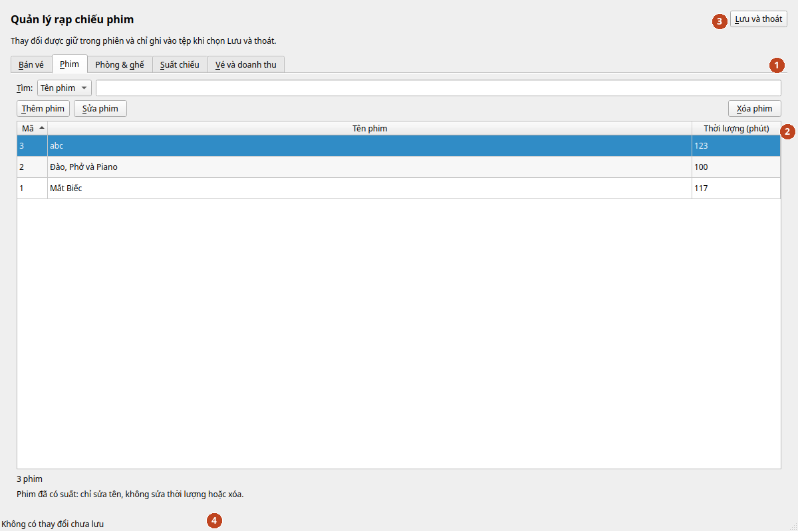
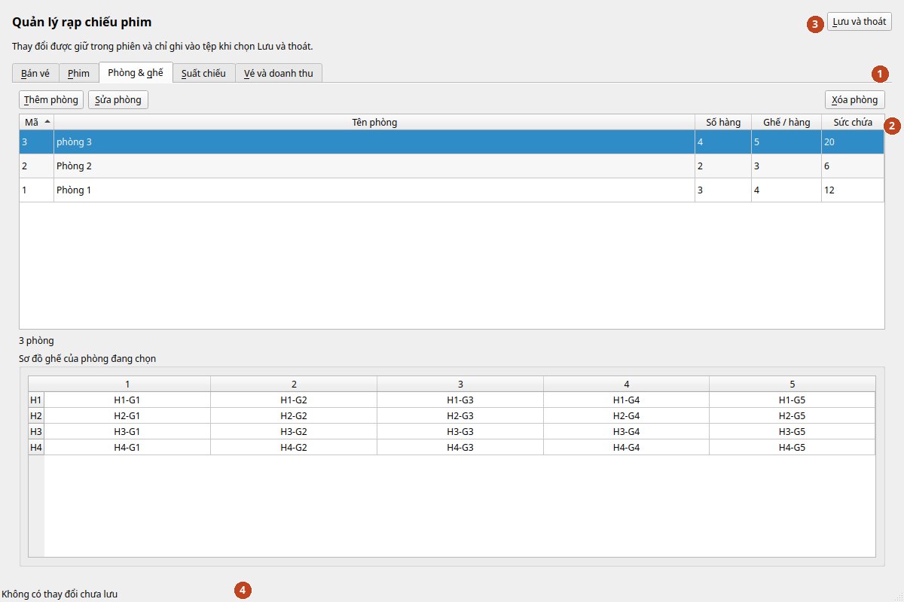
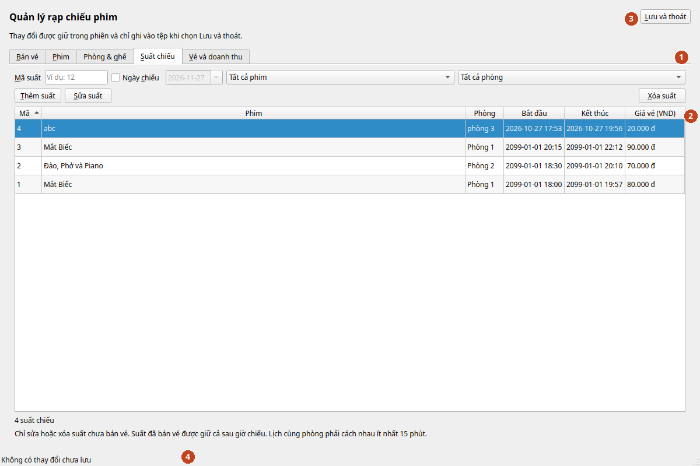
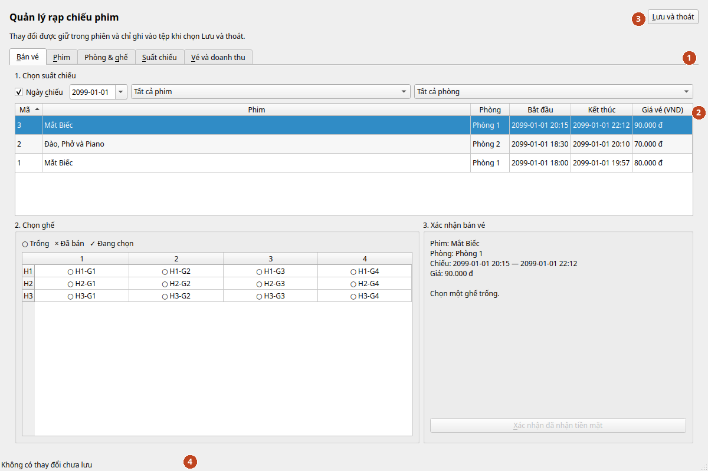
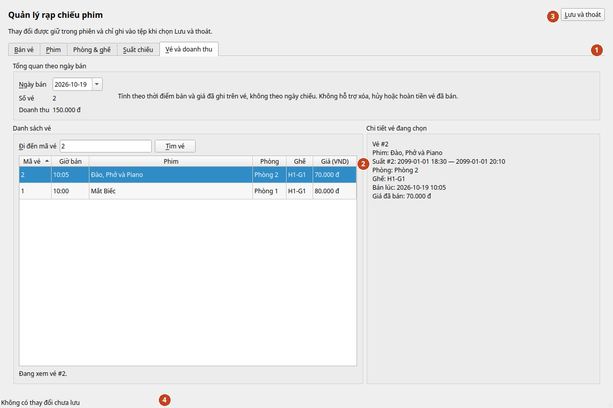

# Hướng dẫn sử dụng

Tài liệu dành cho người vận hành: thao tác ở đâu, theo thứ tự nào và xử lý lỗi
ra sao. Cài công cụ/build/chạy xem [README](../../README.md); chính sách cho phép
hoặc từ chối thao tác xem [quy tắc nghiệp vụ](../requirements/business-rules.md).

Tra cứu chi tiết từng chức năng, chế độ tìm tên/mã, cách kết hợp bộ lọc và giới
hạn hiện tại tại [feature map theo tab](../design/ui-feature-map.md).

## 1. Mở dữ liệu

Chạy `./build/cinema` để dùng trực tiếp `data/demo`, hoặc truyền một thư mục dữ
liệu khác. Nếu muốn thử mà không sửa dữ liệu mẫu, dùng một bản sao theo README.
Thư mục rỗng cần xác nhận trước khi bắt đầu; thiếu một phần bộ file sẽ báo lỗi.

Dữ liệu demo có các suất ngày `2099-01-01`. Nếu tab Bán vé đang lọc ngày hôm
nay và không có kết quả, chọn ngày này hoặc bỏ chọn bộ lọc Ngày chiếu.

## 2. Chuẩn bị danh mục và lịch

Ảnh chụp Qt thực tế bằng nền tảng offscreen, dữ liệu demo; không phải mockup.
Chú thích chung: **①** thanh tab, **②** bảng để chọn bản ghi, **③** Lưu và
thoát, **④** trạng thái thay đổi chưa lưu. Cách hiển thị font/màu có thể khác
theo hệ điều hành. Các số tròn chỉ được thêm vào ảnh tài liệu, không có trong UI.

| Tab | Thao tác |
|---|---|
| Phim | Thêm tên/thời lượng; chọn dòng để sửa hoặc xóa. Chọn kiểu tìm theo tên hoặc mã. |
| Phòng & ghế | Thêm tên, số hàng và số ghế mỗi hàng; chọn phòng để xem sơ đồ, sửa hoặc xóa. |
| Suất chiếu | Chọn phim/phòng, ngày giờ và giá; dùng bộ lọc để tìm suất; chọn dòng để sửa hoặc xóa. |

Với phiên rỗng: tạo phim và phòng trước, sau đó tạo suất. Khi ứng dụng từ chối,
đọc thông báo lỗi; hộp nhập vẫn mở để sửa hoặc hủy. Xóa cần xác nhận.
Chi tiết điều kiện sửa/xóa thuộc Business Rules Catalog, không phải hướng dẫn này.

Phim: ô tìm kiếm ở trên bảng; chọn kiểu tìm trước khi nhập. Chọn một phim ở
② mới bật các thao tác tương ứng.

Tìm tên không phân biệt dấu/hoa thường hoặc thứ tự từ; mỗi từ ít nhất ba ký tự.
Ví dụ tên `Nguyễn Trãi` tìm được bằng `trai nguyen`, `nguy`, `guy`, `nguyn trai`.
Lỗi gõ chỉ hỗ trợ một thao tác khi còn trigram chung, không sửa mọi lỗi chính tả.
Nhập từ ngắn sẽ báo hướng dẫn; xóa ô để xem tất cả. Quy tắc trùng tên không đổi.

Bộ lớn mở bằng `./build/cinema data/sample`; ngày bán mẫu là 28/11/2026,
lịch chiếu bắt đầu 29/11/2026. Xem [hướng dẫn dữ liệu](../../data/sample/README.md)
để tránh nhầm bộ lọc ngày với thiếu dữ liệu.

Phòng và ghế: chọn phòng ở ② để xem bộ ghế phía dưới. Kích thước phòng là số
hàng và số ghế mỗi hàng, không phải danh sách ghế nhập tay.

Suất chiếu: ngày/phim/phòng là bộ lọc tra cứu; nút Thêm mở hộp tạo suất riêng.
Chọn dòng ② để sửa/xóa đúng suất, không sửa trực tiếp các ô trong bảng.

## 3. Bán vé

1. Vào Bán vé, lọc ngày/phim/phòng và chọn một suất.
2. Chọn một ghế trống trên sơ đồ: `○` trống, `×` đã bán, `✓` đang chọn.
3. Kiểm tra thông tin phim, phòng, giờ, ghế và giá.
4. Sau khi nhận tiền, chọn Xác nhận đã nhận tiền mặt và xác nhận thao tác.
5. Ghi nhận mã vé trả về; chọn tiếp ghế khác nếu cần bán thêm.

Mỗi lần xác nhận phát hành một vé. Nếu chưa thấy suất, kiểm tra bộ lọc và giờ
bắt đầu. Không ép đóng tiến trình để hủy thao tác đã hoàn tất.

Ảnh lọc ngày chiếu `2099-01-01`. Chọn suất ở ② trước khi chọn ghế; thông tin
xem trước xuất hiện sau khi chọn một ghế trống. Ô đã bán không thể chọn lại.

## 4. Vé và doanh thu

- Chọn **Ngày bán** để xem danh sách vé, tổng số vé và doanh thu ngày.
- Chọn dòng vé để xem chi tiết, hoặc nhập mã để tra riêng một vé.
- Ngày bán không phải ngày chiếu: bán hôm nay cho suất ngày khác thì xem báo cáo
  của hôm nay. Tra theo mã không phụ thuộc ngày đang lọc.

Ảnh dùng **ngày bán `2026-10-19`** có vé demo. Chọn dòng ② để xem chi tiết;
ô Đi đến mã vé sẽ tự chuyển sang ngày bán của vé tìm được, không tạo danh sách
tra cứu thứ hai.

## 5. Lưu và thoát

Thay đổi chỉ nằm trong phiên cho đến khi lưu. Chọn Lưu và thoát hoặc đóng cửa
sổ rồi xác nhận; hủy xác nhận thì tiếp tục làm việc. Thanh trạng thái cho biết
có thay đổi chưa lưu hay không.

Nếu lưu lỗi, ứng dụng giữ cửa sổ và dữ liệu trên RAM. Sửa quyền ghi/dung lượng
hoặc nguyên nhân được báo rồi thử lại. Không xóa các thư mục phục hồi tùy tiện;
quy trình kỹ thuật nằm trong [định dạng TXT và phục hồi](../design/txt-format.md).

Giới hạn sử dụng: không mở hai phiên trên cùng dữ liệu; không sửa TXT trực tiếp.
Chương trình bị buộc dừng có thể làm mất thay đổi chưa lưu.
