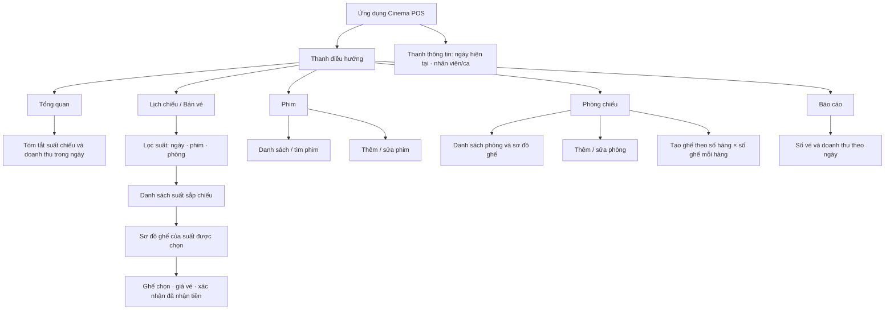
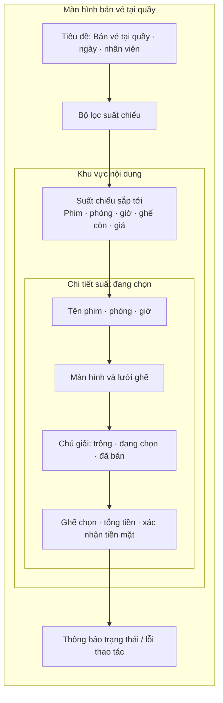
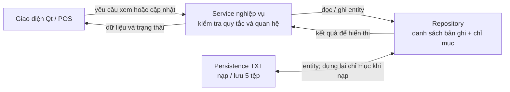
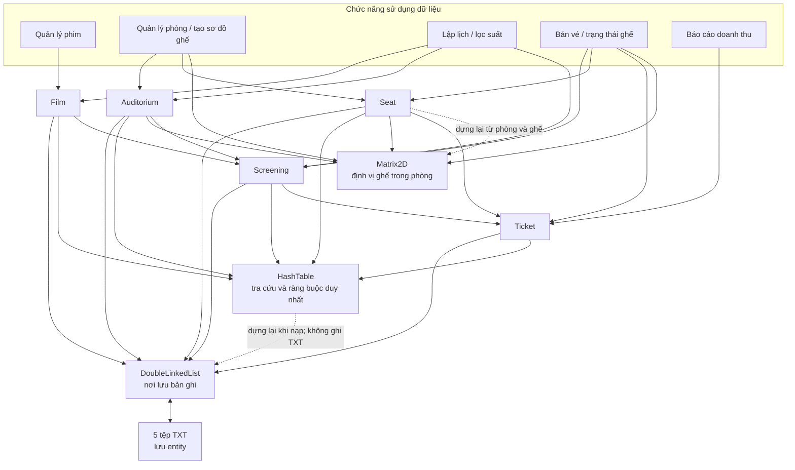

# Sơ đồ giao diện và phụ thuộc dữ liệu

Tài liệu này mô tả giao diện POS dự kiến của hệ thống quản lý rạp chiếu phim và cách mỗi chức năng sử dụng entity, cấu trúc dữ liệu cùng tệp lưu trữ tương ứng. Mô hình entity và quy tắc nghiệp vụ chi tiết được quy định trong [structure.md](./structure.md); định dạng các tệp TXT nằm tại [docs/design/txt-format.md](./docs/design/txt-format.md).

> **Trạng thái hiện tại:** [graphics.html](./graphics.html) là wireframe tĩnh cho màn hình bán vé; bộ lọc và nút chưa kết nối nghiệp vụ. Workspace hiện chỉ giữ các header `DoubleLinkedList`, `HashTable` và `Matrix2D`, không còn màn hình, entity, repository, service hay persistence đã triển khai. Các sơ đồ bên dưới mô tả thiết kế dự kiến, không khẳng định các chức năng đã chạy được.

## 1. Sơ đồ điều hướng giao diện

### Bố cục màn hình bán vé

Trạng thái **đang chọn** chỉ tồn tại tạm thời trên giao diện. Ghế chỉ trở thành **đã bán** sau khi service xác nhận giao dịch và tạo `Ticket` thành công.

## 2. Luồng từ giao diện đến dữ liệu

UI không thao tác trực tiếp với repository hay tệp. Chỉ mục băm là dữ liệu dẫn xuất trong RAM, không ghi ra TXT. Khi nạp dữ liệu, hệ thống kiểm tra toàn bộ bản ghi và quan hệ trước khi thay trạng thái đang dùng.

## 3. Chức năng phụ thuộc vào entity và cấu trúc dữ liệu

Các cấu trúc dưới đây là lựa chọn trong thiết kế. Tên header cấu trúc đã có trong workspace là `DoubleLinkedList.h`, `HashTable.h` và `Matrix2D.h`.

| Chức năng | Entity đọc/ghi | Cấu trúc dữ liệu sử dụng | Quan hệ / chỉ mục quan trọng |
|---|---|---|---|
| Quản lý phim | `Film` | `DoubleLinkedList<Film>` lưu bản ghi; `HashTable<film_id, ID/handle>` tra cứu theo ID | Tìm tên có thể chuẩn hóa hoặc duyệt danh sách; chỉ sửa/xóa phim khi không có suất tham chiếu. |
| Quản lý phòng chiếu | `Auditorium`, `Seat` | Danh sách đôi cho bản ghi; bảng băm theo ID và vị trí ghế; `Matrix2D<seat_id>` cho sơ đồ ghế | Mỗi phòng có `row_count × seats_per_row` ghế; ô `(row - 1, seat - 1)` chứa `seat_id`. |
| Tạo / hiển thị sơ đồ ghế | `Auditorium`, `Seat` | `Matrix2D<seat_id>` định vị ghế; `DoubleLinkedList<Seat>` lưu entity; `HashTable` ánh xạ vị trí đến ghế | Ma trận là cấu trúc định vị, không thay thế entity `Seat`. |
| Lập và tra cứu lịch chiếu | `Screening`, `Film`, `Auditorium` | Danh sách đôi cho suất; bảng băm theo `screening_id`, có thể lập chỉ mục theo phòng, phim hoặc ngày | Service đọc thời lượng phim để tính giờ kết thúc và kiểm tra lịch chồng lấn trong phòng. |
| Lọc suất / hiển thị suất sắp tới | `Screening`, `Film`, `Auditorium`, `Ticket` | Chỉ mục suất theo phòng/phim/ngày nếu cần; ma trận ghế và chỉ mục vé để tính ghế còn | Giờ kết thúc và trạng thái ghế được suy ra; không lưu thành entity riêng. |
| Bán vé tại quầy | `Screening`, `Seat`, `Ticket` cùng thông tin `Film` và `Auditorium` | `Matrix2D<seat_id>` dựng sơ đồ; `HashTable<(screening_id, seat_id), ticket_id>` chặn bán trùng; danh sách đôi lưu vé | Kiểm tra lại suất, phòng và ghế khi xác nhận tiền; chốt giá vào `Ticket.unit_price`; cập nhật vé và chỉ mục như một thao tác nguyên tử. |
| Báo cáo doanh thu ngày | `Ticket` | Danh sách vé; chỉ mục ngày bán có thể dùng để thu hẹp dữ liệu | Cộng `unit_price` theo ngày của `sold_at`; số vé và doanh thu là giá trị tính toán. |
| Nạp / lưu dữ liệu | Cả năm entity | Danh sách đôi chứa bản ghi; dựng lại `HashTable` và ma trận ghế sau khi kiểm tra dữ liệu | Đọc/ghi `films.txt`, `auditoriums.txt`, `seats.txt`, `screenings.txt`, `tickets.txt`; không lưu chỉ mục. |

### Sơ đồ phụ thuộc chức năng

### Ý nghĩa của ba cấu trúc chính

- **`DoubleLinkedList<T>`**: lưu các bản ghi entity; duyệt và xóa bản ghi. Chỉ mục không được phụ thuộc vào địa chỉ node nếu thao tác sao chép/di chuyển làm thay đổi địa chỉ.
- **`HashTable<Key, Value>`**: tra cứu nhanh theo ID, vị trí ghế, hoặc khóa ghép `(screening_id, seat_id)` để ngăn bán trùng một ghế trong cùng suất. Cần cập nhật nhất quán cùng danh sách bản ghi.
- **`Matrix2D<T>`**: biểu diễn vị trí ghế theo hàng/cột của một phòng. Ma trận phòng không chứa trạng thái vé; trạng thái trống/đã bán được tính từ vé của suất đang xem.
