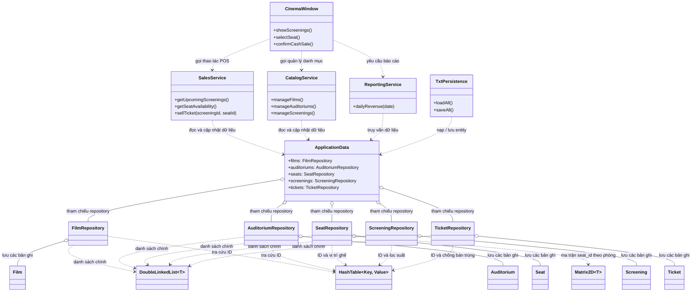
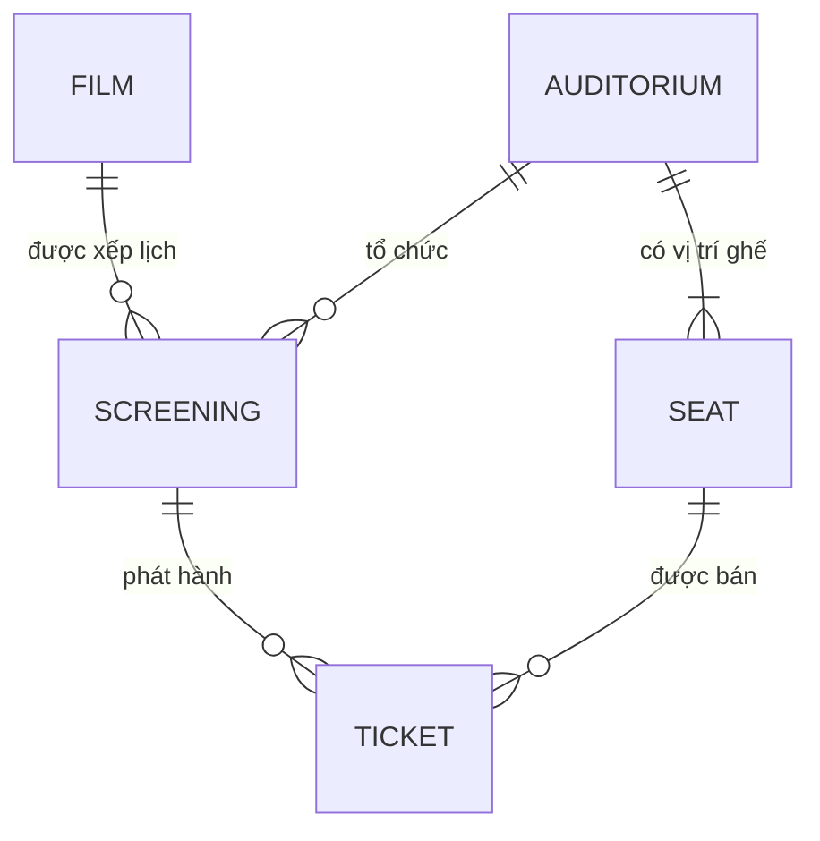
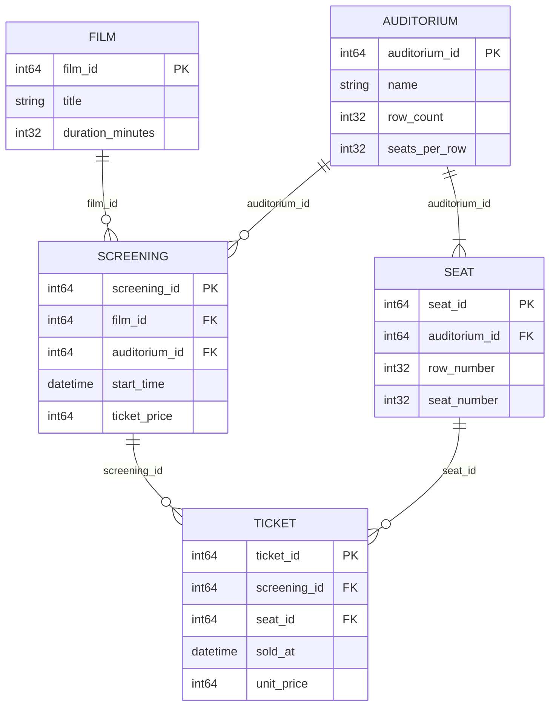

# Ý tưởng hệ thống quản lý rạp chiếu phim

## 1. Mục tiêu và phạm vi

Hệ thống quản lý rạp chiếu phim là ứng dụng desktop offline cho một nhân viên vận hành tại một thời điểm. Mục tiêu là quản lý phim, phòng và ghế, lịch chiếu, bán vé tiền mặt tại quầy, tra cứu doanh thu theo ngày, đồng thời thực hành C++17, OOP và các cấu trúc dữ liệu tự cài đặt.

Thiết kế giao diện POS được minh họa tại [graphics.html](./graphics.html) và [graphics.md](./graphics.md). Các quy tắc dữ liệu, bất biến và chỉ mục được mô tả chi tiết trong [structure.md](./structure.md); định dạng lưu trữ nằm trong [docs/design/txt-format.md](./docs/design/txt-format.md).

> **Phạm vi mã hiện tại:** workspace chỉ còn các header cấu trúc dữ liệu `DoubleLinkedList`, `HashTable` và `Matrix2D`. Các lớp nghiệp vụ, repository, service, persistence và giao diện Qt bên dưới là thiết kế đề xuất, chưa phải các module đã triển khai.

### Chức năng dự kiến

- Quản lý phim, phòng chiếu, sơ đồ ghế và suất chiếu.
- Lọc suất sắp chiếu theo ngày, phim và phòng.
- Chọn ghế, xác nhận đã nhận tiền mặt và phát hành vé; ngăn bán trùng ghế trong cùng suất.
- Tra cứu trạng thái ghế theo suất và báo cáo số vé/doanh thu theo ngày.
- Nạp và lưu dữ liệu từ năm tệp TXT.

### Ngoài phạm vi

Không triển khai tài khoản/phân quyền, đặt chỗ hoặc giữ ghế, hoàn vé, thông tin khách hàng, thanh toán trực tuyến, đồng bộ nhiều máy hay lưu trữ bằng DBMS.

## 2. Kiến trúc lớp và quan hệ Aggregation

Thiết kế chia trách nhiệm thành giao diện, service nghiệp vụ, repository, entity và persistence. Giao diện chỉ giữ trạng thái trình bày tạm thời; mọi thay đổi dữ liệu phải đi qua service.

### Ý nghĩa của Aggregation

- Ký hiệu hình thoi rỗng `o--` biểu diễn **aggregation**: `ApplicationData` tập hợp/tham chiếu các repository, nhưng không sở hữu vòng đời của chúng. Repository phải được tạo và hủy ở nơi quản lý bên ngoài; chúng phải còn sống lâu hơn `ApplicationData`.
- Quan hệ giữa repository và entity cũng được mô hình hóa là aggregation ở mức thiết kế: repository quản lý các bản ghi trong danh sách của nó, nhưng entity vẫn là khái niệm nghiệp vụ độc lập. Khi triển khai, repository chịu trách nhiệm lưu trữ và bảo đảm tính nhất quán của bản ghi/chỉ mục.
- Mũi tên nét đứt `..>` biểu diễn phụ thuộc sử dụng: UI gọi service; service dùng dữ liệu qua repository; persistence trao đổi entity với tầng dữ liệu.
- Các cấu trúc `DoubleLinkedList`, `HashTable`, `Matrix2D` là chi tiết lưu trữ/tra cứu của repository, không phải entity nghiệp vụ và không được ghi ra TXT.
- `CinemaWindow` không truy cập trực tiếp repository hoặc TXT. `SalesService` phải kiểm tra lại điều kiện bán tại thời điểm xác nhận, không dựa riêng vào trạng thái ghế tạm trên UI.

## 3. ERD khái niệm

- Một `Film` có thể chưa có hoặc có nhiều `Screening`; mỗi `Screening` chiếu đúng một phim.
- Một `Auditorium` có nhiều `Seat` theo kích thước sơ đồ; mỗi `Seat` thuộc đúng một phòng.
- Một `Auditorium` có thể chưa có hoặc có nhiều `Screening`; mỗi `Screening` sử dụng đúng một phòng.
- Một `Screening` có thể chưa có hoặc có nhiều `Ticket`; mỗi `Ticket` thuộc đúng một suất.
- Một `Seat` có thể xuất hiện trên vé của nhiều suất khác nhau; mỗi `Ticket` gắn với đúng một ghế. Cặp `(screening_id, seat_id)` chỉ được xuất hiện tối đa một lần.

## 4. ERD thuộc tính và khóa

### Ý nghĩa thuộc tính và ràng buộc liên kết

| Entity | Thuộc tính | Ý nghĩa / ràng buộc |
|---|---|---|
| `Film` | `film_id` (PK) | ID dương, duy nhất và bất biến. |
| | `title` | Tên phim bắt buộc, không rỗng sau khi trim. |
| | `duration_minutes` | Thời lượng dương; chỉ sửa khi phim chưa có suất. |
| `Auditorium` | `auditorium_id` (PK) | ID dương, duy nhất và bất biến. |
| | `name` | Tên phòng bắt buộc. |
| | `row_count`, `seats_per_row` | Kích thước dương; tích hai giá trị xác định số ghế của sơ đồ đầy đủ. |
| `Seat` | `seat_id` (PK) | ID dương, duy nhất. |
| | `auditorium_id` (FK) | Tham chiếu phòng tồn tại. |
| | `row_number`, `seat_number` | Vị trí bắt đầu từ 1 và nằm trong kích thước phòng; duy nhất theo bộ `(auditorium_id, row_number, seat_number)`. |
| `Screening` | `screening_id` (PK) | ID dương, duy nhất. |
| | `film_id` (FK) | Tham chiếu phim tồn tại. |
| | `auditorium_id` (FK) | Tham chiếu phòng tồn tại. |
| | `start_time` | Thời điểm bắt đầu hợp lệ; giờ kết thúc được tính bằng thời lượng phim. |
| | `ticket_price` | Giá vé VND dương. Lịch trong cùng phòng không được chồng lấn, tính cả 15 phút đệm sau suất. |
| `Ticket` | `ticket_id` (PK) | ID dương, chỉ cấp khi bán thành công. |
| | `screening_id` (FK) | Tham chiếu suất tồn tại. |
| | `seat_id` (FK) | Tham chiếu ghế thuộc chính phòng của suất đó. |
| | `sold_at` | Thời điểm xác nhận đã nhận tiền mặt. |
| | `unit_price` | Giá VND chốt tại lúc bán, không phụ thuộc giá suất thay đổi về sau. |

Các FK biểu diễn quan hệ entity, nhưng một số ràng buộc cần kiểm tra ở service/repository chứ không thể hiện đầy đủ bằng khóa ngoại đơn: ghế của vé phải thuộc phòng của suất; không trùng `(screening_id, seat_id)`; không sửa/xóa phim hoặc phòng đang được suất tham chiếu; không sửa/xóa suất đã có vé.

## 5. Cấu trúc dữ liệu gắn với chức năng

| Chức năng | Dữ liệu chính | Cấu trúc dự kiến |
|---|---|---|
| Tra cứu và quản lý phim | `Film` | `DoubleLinkedList<Film>` và `HashTable<film_id, ID/handle>`. |
| Quản lý phòng và sơ đồ ghế | `Auditorium`, `Seat` | Danh sách bản ghi; `HashTable` tra ID/vị trí; `Matrix2D<seat_id>` theo hàng và cột. |
| Lập/lọc suất | `Screening`, `Film`, `Auditorium` | Danh sách suất; `HashTable` theo ID, có thể thêm chỉ mục theo phòng, phim hoặc ngày. |
| Bán vé và trạng thái ghế | `Screening`, `Seat`, `Ticket` | Ma trận ghế để hiển thị; `HashTable<(screening_id, seat_id), ticket_id>` để chặn bán trùng; danh sách vé. |
| Báo cáo doanh thu | `Ticket` | Duyệt vé hoặc lọc bằng chỉ mục ngày; cộng `unit_price` theo ngày `sold_at`. |
| Nạp/lưu | Cả năm entity | Năm tệp TXT giữ dữ liệu gốc; các bảng băm và ma trận được dựng lại trong RAM. |

Sức chứa, giờ kết thúc, trạng thái ghế theo suất và doanh thu là dữ liệu suy ra, không tạo thành entity/thuộc tính lưu trữ riêng. Trạng thái “đang chọn” chỉ thuộc UI, không giữ ghế và không tạo bản ghi.

## 6. Luồng bán vé

1. UI yêu cầu `SalesService` lọc các suất chưa bắt đầu theo ngày, phim hoặc phòng.
2. Service lấy thông tin phim/phòng/suất và dựng trạng thái ghế từ ma trận phòng cùng các vé của suất.
3. Nhân viên chọn ghế; lựa chọn tạm chỉ nằm ở UI. Service có thể kiểm tra tình trạng hiện tại nhưng chưa tạo vé.
4. Khi xác nhận đã nhận tiền mặt, service kiểm tra lại thời điểm, quan hệ suất-phòng-ghế và khóa duy nhất `(screening_id, seat_id)`.
5. Service tạo `Ticket`, chốt `unit_price`, thêm bản ghi và cập nhật chỉ mục như một thao tác nguyên tử. Nếu bước nào thất bại, dữ liệu không được ở trạng thái cập nhật dở dang.
6. UI hiển thị vé đã bán sau khi service trả kết quả thành công.

## 7. Lưu trữ và tính nhất quán

Dữ liệu bền vững gồm `films.txt`, `auditoriums.txt`, `seats.txt`, `screenings.txt`, `tickets.txt`. Khi nạp, hệ thống đọc vào trạng thái tạm, kiểm tra định dạng, ID, FK, vị trí ghế, lịch và vé; chỉ thay dữ liệu phiên hiện tại khi toàn bộ bộ dữ liệu hợp lệ. Khi lưu hoặc đóng ứng dụng, phải báo lỗi rõ ràng nếu bất kỳ tệp nào không ghi hoàn tất; không báo thành công giả hoặc đóng khi lưu thất bại.
